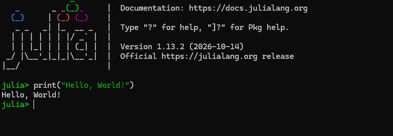

## 

In this presentation:

- I will introduce the Julia programming language
- discuss features and packages
- Look at some of the strengths and weaknesses of julia
- demonstrate an example using julia to perform dynamic modelling and analyses

## Julia {.smaller}

{.absolute right="10" width="320" height="200"}

- First released in 2012
- \> 12,000 registered packages (and more on GitHub)

- Developed to combine features from many languages:
    - Open-source and -access
    - Speed of C
    - Dynamic high-level interface
    - General and machine learning applications of Python
    - Data science and statistical analyses of Python and R

. . .

{.absolute top="500" left="5" width="774" height="268"}

## Features {.smaller}

- Just-in-time compilation

Julia compiles functions into machine code the first time they are run in a session,
allowing C / C++ speeds for subsequent calls.

- Multiple-dispatch

A single julia function can express different behaviour depending on the types of
arguments used.

- Environment package manager

The package manager sets up environments that track package versions, allowing
fully reproducible workflows and easy handling of package dependencies.

- Simple parallelisation

Easily parallelise code with `Threads.jl` or `FLoops.jl`.

## Some standout Julia packages {.smaller}

[Makie.jl](https://docs.makie.org/stable/) for fast and fully customisable data plotting.
Including large datasets, interactive plots and animations.

. . .

 
[Turing.jl](https://turinglang.org/) for fast and flexible Bayesian modelling.

. . .

 
[DifferentialEquations.jl](https://docs.sciml.ai/DiffEqDocs/stable/) for solving
many types of differential equations.

. . .

 
[CUDA.jl](https://cuda.juliagpu.org/stable/) for easily writing GPU-compatible code
from Julia.

. . .

 
[MLJ.jl](https://juliaml.ai/) / [Flux.jl](https://fluxml.ai/Flux.jl/stable/) for
machine learning.

. . .

 
[YAXArrays.jl](https://juliadatacubes.github.io/YAXArrays.jl/stable/) useful for
working with large data sets (e.g. plotting / analysing climate data).

. . .

 
[JuMP.jl](https://jump.dev/) framework for mathematical optimisation. Used to solve
real-world problems, including at distribution at Renault.

. . .

 
[MixedModels.jl](https://juliastats.org/MixedModels.jl/v5.8/for_r_users/) for linear and
generalized linear mixed-effect modelling. Developed as a successor to R's `lme4`.

## Who should consider Julia? {.smaller}

Someone:

- *Wanting to learn a new language*: julia has many useful features that are
interesting to learn: rich types, multiple dispatch and macros / metaprogramming

. . .

 

- *Writing custom code that performs many calculations*: (Avoiding the two-language
 problem) Custom repetitive code makes the most of julia's quick
development and runtime.
    - Dynamic population / ecosystem modelling
    - Performing custom analyses on large datasets

. . .

 

- *Using parallel processing*: julia has shared-memory multithreading and
distributed computing built-in with `Threads` and `Distributed`, as well as 
being able to write GPU code in Julia itself (`CUDA.jl`)

. . .

 

## Maybe not someone: {.smaller}

. . .

- *Running short, one-off analyses / scripts*: julia's JIT compilation means that the
there is slower initial startup / first runs. Code that repeatedly uses functions
benefits more from julia's speed.

. . .

 

- *Using strong existing packages in R/Python*: julia's ecosystem is not as
developed as R/Python, so some analyses are smoother in other languages, e.g.
meta-analyses (`metafor`), GAMs (`mgcv`), deep-learing (`pytorch`).

## Some useful resources  {.smaller}

If you are wanting to learn some Julias:

[Julia learning page - resources for all levels](https://julialang.org/learning/)

[Julia language documentation](https://docs.julialang.org/en/v1/)

[Video: Introduction to Julia (language basics)](https://youtu.be/46hkaaDBgX4?si=sfBOJA2IooPR1o9X)

 
If you want to get the most speed out of your julia code:

[Performance tips](https://docs.julialang.org/en/v1/manual/performance-tips/)

 
If you want to use R / Python packages from within Julia:

[RCall.jl](https://juliainterop.github.io/RCall.jl/stable/)

[PythonCall.jl](https://juliapy.github.io/PythonCall.jl/stable/)

## Any questions so far?

Next we will go into an example where julia can excel.

- Dynamic population modelling
- Output data exploration
- Plotting with Makie.jl and AlgebraOfGraphics.jl

[GitHub: eco-ben/jl_ecomodel_example](https://github.com/eco-ben/jl_ecomodel_example)

 

Let me know if there's anything else you are keen to hear about with Julia.

